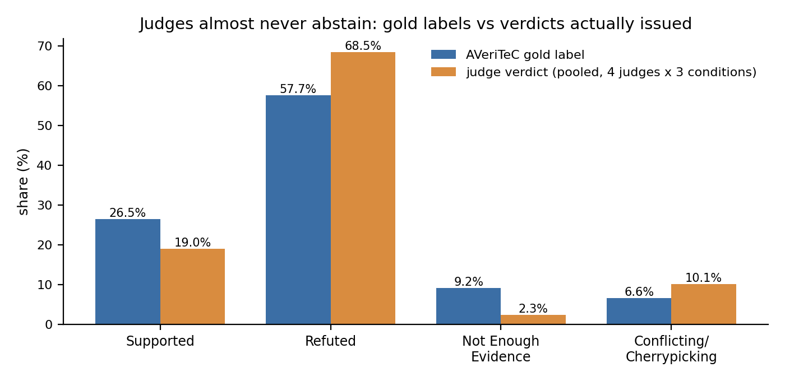

# Caveats In, Verdicts Unchanged: A Pre-Declared Retrieval-Context Ablation of LLM Fact-Check Judges on AVeriTeC

**Ana** (GitHub `anaexplores`)
Independent researcher
**With** Apart Research

> Research conducted at the [AI x Epistemics Research Sprint](https://apartresearch.com/sprints/ai-x-epistemics-research-sprint-2026-11-13-to-2026-11-15), November 2026.

## Abstract

Fact-checking pipelines often retrieve "caveat" passages alongside supporting ones: short windows with limiting words like *however*, *partially*, or *misleading*, on the view that hedging context makes an LLM judge more careful. We tested that directly on the external AVeriTeC benchmark, using its official labels, 196 claims, and four judge models from four families. Condition A shows support windows only. Condition B adds caveat windows from the same article. Condition C adds caveat windows from a random other article. Caveats changed nothing. All 12 paired comparisons were non-significant after Holm correction, verdicts flipped on 7.7% to 10.2% of claims, and the minimum detectable effect was 3.6 percentage points. Condition C did not hurt accuracy either, so irrelevant hedging text is not an attack surface here.

The ablation exposed a larger failure: judges almost never abstain. Of 216 attempts on "Not Enough Evidence" claims, exactly one was correct. Judges used that label in 2.3% of verdicts against a 9.2% true share, and the majority class carries almost all the accuracy. Retrieval is the wrong lever for this failure; scoring rules that reward guessing are the right place to look.

## 1. Introduction

Most automated fact-checkers retrieve passages from an article, hand them to an LLM, and ask for a verdict. Our preexisting tool `lost-caveats` adds a second pass: besides *support* windows that carry the evidence, it retrieves *caveat* windows with limiting words like "however", "but", or "partially accurate". A judge shown only confirming text tends to confirm; caveat windows are meant to counteract that.

Because this intervention is plausible and cheap, it should be measured rather than assumed. We also test whether content matters. Condition C keeps the window count and marker density of Condition B, but draws caveat windows from a different, randomly chosen article. If B beats A while C does not, relevant caveats help. If B and C behave alike, content is not what matters.

**Our main contributions are:**

1. A pre-declared retrieval-context ablation on AVeriTeC (official labels, four judge families, relevant and irrelevant caveat conditions), showing a null result with a 3.6 percentage point minimum detectable effect.
2. Evidence that the main failure of LLM fact-check judges is **refusal to abstain**: 1 correct verdict in 216 attempts on "Not Enough Evidence" claims, with the label used in 2.3% of verdicts against a 9.2% true rate.
3. A 13-gate cleanliness harness (`pipeline/gates.py`) where every gate is tested by injecting a violation into the artefact it guards, finding zero cross-condition contamination across 2352 quotes.

## 2. Related Work

**Claim verification benchmarks.** AVeriTeC (Schlichtkrull, Guo & Vlachos, 2023) provides 4,568 real-world claims from 50 fact-checking organisations, four labels (Supported, Refuted, Not Enough Evidence, Conflicting Evidence/Cherrypicking), and kappa = 0.619 agreement. Official evaluation requires both a correct verdict and retrieved evidence above a quality threshold. We score verdicts only, because our question is context sensitivity. Official test labels are private, so our test side comes from the official train split.

**Abstention and the incentive to guess.** Kalai et al. (2025) show that binary grading gives zero for "I don't know", making confident guessing dominant. We test this on a benchmark with an explicit abstention label. The rare labels are known to be hard. Across the 21 systems in the 2024 shared task, the average AVeriTeC score on Not Enough Evidence was 0.06, and the winner scored 0.12 there vs 0.73 on Refuted (Schlichtkrull et al., 2024). Many teams ignored the two rare labels, and one disabled them because its prompted model overpredicted them. We isolate the verdict layer from retrieval. Judges see windows from the claim's own article, where an abstaining verdict is stated outright. Even so, they issue Not Enough Evidence in 2.3% of verdicts (9.2% true) while over-issuing Conflicting Evidence at 10.1% (6.6% true). Judges reach for the adjacent hedging label, not the abstaining one. Models often carry calibrated P(True) and P(IK) self-knowledge signals (Kadavath et al., 2022); we did not elicit confidence, so we cannot separate inability from unwillingness to abstain. Related benchmarks separate honesty from accuracy (Ren et al., 2025, MASK) and measure sycophancy and dark patterns (Kran et al., 2025, DarkBench; Fanous et al., 2025, SycEval). We test whether a retrieval change moves verdicts.

**Methodological grounding.** We use exact McNemar (McNemar, 1947; Dietterich, 1998), Wilson intervals (Brown, Cai & DasGupta, 2001), Holm correction, and explicit power reporting (Dror et al., 2018; Card et al., 2020). Following leakage guidelines (Gorman & Bedrick, 2019; Kapoor & Narayanan, 2023) and variance reporting standards (Reimers & Gurevych, 2017; Bouthillier et al., 2021; Lipton & Steinhardt, 2018), we group by article, stratify by label, and fix one seed.

**Preexisting vs new work.** The caveat-window idea, BM25 windowing, and marker list are **preexisting** from `lost-caveats` v0.1.1 (released before this sprint). All other code, the AVeriTeC split, runner, blind-label machinery, judge sessions, statistics, gates, and this report are **new sprint work**.

## 3. Methods

**Data and split.** From the official AVeriTeC repository (`MichSchli/AVeriTeC`, CC BY-NC 4.0, SHA-256 in `data/MANIFEST.json`), we drew 100 tuning and 200 test claims (seed 20261115), grouped by article and stratified by label. Zero articles overlap between sides, and cross-split articles are excluded from tuning. We never labelled anything ourselves. Four test claims were excluded **before any judge ran** because their articles are JS-rendered misbar.com Wayback captures with no static text. That leaves n = 196 (9 batches of 20, 1 of 16; 3 Supported and 1 Refuted excluded).

**Conditions.** Passages are ranked by BM25 from the claim's fact-checking article. Condition A shows the top 5 support windows (120 words). Condition B adds 5 caveat windows (40 words, same article) selected by limiting markers. Condition C adds 5 caveat windows of the same length and marker density from a random other article. Claims, order, batching, instructions, and schema are identical across conditions.

**Judge panel and isolation.** We run one model per family (`claude-haiku-5-5`, `gemini-4-argon`, `gpt-6-luna`, `deepseek-v4-pro`) and never pool across judges. Each (judge, condition, batch) cell runs in a fresh subagent session (120 test cells): one prompt file in, one JSON file out, no access to `labels_secret` or other cells. Retries use a new session. Verification against the OpenCode session store confirmed 125 judge sessions (120 cells plus five registered retries and blocked attempts), no reused sessions, and zero verdicts from the orchestrator (`docs/EXPERIMENT_DESIGN.md`).

**Statistics (declared in writing before scoring).** We report four-way exact-match accuracy with 95% Wilson intervals and exact McNemar tests across {A vs B, B vs C} (mandatory) and {A vs C} (optional), Holm-corrected. With n = 196, McNemar needs at least 7 net discordant pairs to survive Holm, giving a **3.6 percentage point minimum detectable effect**. Conditions, panel, batching, and exclusions were fixed before the first cell ran. The written analysis plan was fixed after waves A and B finished, before wave C and before any scoring (pre-scoring, not pre-run).

**Deviation and gates.** A content filter blocked `deepseek-v4-pro` three times on A/batch00; a free same-family fallback (`deepseek-v4.1-flash-free`) produced that cell. We logged the deviation before analysis and report DeepSeek A-comparisons both with and without batch00 (n = 176; they agree). Thirteen machine gates (`pipeline/gates.py`, Appendix C) enforce protocol freeze, label blindness, template identity, quote provenance, and session isolation, each proven red by `--selftest`. This run returned 0 FAIL across all 13 gates (`results_gates_audit.txt`, `docs/GATES.md`).

## 4. Results

**Observation 1: caveat windows do not change verdicts.** Accuracy per judge varies by at most two points across conditions, with no consistent direction (Table 1). These verdict-only numbers on gold-article windows cannot be compared to the official AVeriTeC leaderboard, where the 2024 shared-task winner reached 63% on verdict plus retrieved evidence (Schlichtkrull et al., 2024). Our task is much easier and isolates verdict sensitivity.

| Judge | A (support) | B (support + caveats) | C (support + foreign caveats) |
|---|---|---|---|
| claude-haiku-5-5 | 145/196 = 74.0% [0.67,0.80] | 146/196 = 74.5% [0.68,0.80] | 143/196 = 73.0% [0.66,0.79] |
| deepseek-v4-pro | 149/196 = 76.0% [0.70,0.81] | 146/196 = 74.5% [0.68,0.80] | 150/196 = 76.5% [0.70,0.82] |
| gemini-4-argon | 146/196 = 74.5% [0.68,0.80] | 150/196 = 76.5% [0.70,0.82] | 149/196 = 76.0% [0.70,0.81] |
| gpt-6-luna | 145/196 = 74.0% [0.67,0.80] | 147/196 = 75.0% [0.68,0.81] | 146/196 = 74.5% [0.68,0.80] |

*Table 1. Exact-match accuracy against AVeriTeC gold labels, with 95% Wilson intervals in brackets (n = 196). Majority-class baseline (always "Refuted") is 113/196 = 57.7%.*

All 12 paired comparisons are non-significant (Table 2): raw McNemar p-values are 0.2891 to 1.0000, and every Holm-adjusted p-value is 1.0000. A judge changes its verdict on 4.1% to 8.2% of claims between any two conditions, and 7.7% to 10.2% across all three. Two judges in the same condition agree on 88.2% (A), 90.1% (B), and 87.3% (C) of claims. Swapping the judge therefore changes about as many verdicts as swapping the context, and on average slightly more. Excluding the DeepSeek fallback batch (n = 176) gives the same result: A vs B b=3 c=1, p=0.6250; A vs C b=3 c=3, p=1.0000.

| Comparison | claude-haiku-5-5 | deepseek-v4-pro | gemini-4-argon | gpt-6-luna |
|---|---|---|---|---|
| A vs B (mandatory) | b=2 c=3, p=1.0000 | b=5 c=2, p=0.4531 | b=3 c=7, p=0.3438 | b=3 c=5, p=0.7266 |
| B vs C (mandatory) | b=5 c=2, p=0.4531 | b=2 c=6, p=0.2891 | b=3 c=2, p=1.0000 | b=4 c=3, p=1.0000 |
| A vs C (optional) | b=4 c=2, p=0.6875 | b=3 c=4, p=1.0000 | b=3 c=6, p=0.5078 | b=4 c=5, p=1.0000 |

*Table 2. Exact McNemar discordant counts (b = first condition only, c = second only) on 196 paired claims, with two-sided p-values.*

**Observation 2: irrelevant caveats do not degrade verdicts.** Condition C adds five unrelated hedging windows per claim without lowering accuracy for any judge (Tables 1 and 2).

**Observation 3: judges do not abstain.** Table 3 and Figure 1 compare true label shares against issued verdicts. Of 216 attempts on "Not Enough Evidence" claims (18 unique claims rated 12 times; the claim is the independent unit), exactly one was correct. Judges issued that label 55 times in 2352 verdicts, placing the misses into Refuted (176) and Conflicting/Cherrypicking (31). In the shared task's human evaluation, systems similarly predicted Not Enough Evidence on 22.1% of human-labelled NEE cases and Refuted on 60.3% (Schlichtkrull et al., 2024); removing retrieval sharpens this to near-zero abstention. Overall accuracy (73.0% to 76.5%) sits 15 to 19 points above the 57.7% majority baseline, driven almost entirely by Refuted (94.4%).

| Label | Gold share | Judges issue it | Accuracy on that label |
|---|---|---|---|
| Supported | 26.5% | 448/2352 = 19.0% | 413/624 = 66.2% |
| Refuted | 57.7% | 1611/2352 = 68.5% | 1280/1356 = 94.4% |
| Not Enough Evidence | 9.2% | 55/2352 = 2.3% | 1/216 = 0.5% |
| Conflicting/Cherrypicking | 6.6% | 238/2352 = 10.1% | 68/156 = 43.6% |

*Table 3. Gold shares over the 196 claims; usage and per-label accuracy pooled over 4 judges x 3 conditions (2352 verdicts).*

*Figure 1. Gold label distribution versus issued verdicts, pooled over four judges and three conditions. "Not Enough Evidence" is true of 9.2% of claims but issued in 2.3% of verdicts (1/216 correct), while "Refuted" carries 94.4% accuracy.*

**Interpretation and robustness.** In AVeriTeC, the fact-check article usually states its conclusion outright, and BM25 support windows include it. The judge locates a stated conclusion rather than weighing evidence, so extra hedging windows have nothing to do, and an article concluding "not enough evidence" is still read as a negative conclusion. The gates confirm clean delivery: 30 byte-identical headers (sha256 `f948718f22f07be4`), identical 196-claim batch order, 588 verified hidden labels, and 2297 of 2352 quotes verbatim in their own condition with **zero cross-condition contamination**. Per-judge verbatim quote rates are 0.9983 (gemini), 0.9949 (claude), 0.9915 (gpt), and 0.9218 (deepseek, which paraphrases more often).

## 5. Discussion and Limitations

**Implication for AI safety.** Retrieval tweaks do not fix refusal to abstain when the grading rule rewards guessing. Under exact-match scoring on a four-way label set, a wrong guess and an honest abstention both score zero, so guessing dominates (Kalai et al., 2025). A benchmark reporting 74.0% accuracy alongside 0.5% on its abstention class is not measuring calibrated judgement.

### Limitations

- **Verdict recovery.** Windows come from the same article as the label. Shared-task organisers removed fact-checking articles from their knowledge store as leakage (Schlichtkrull et al., 2024). We sit inside that leakage on purpose to test what judges do when the verdict is in front of them.
- **Single window setup.** 5 x 120 support words and 5 x 40 caveat words (BM25). We did not sweep lengths or counts, and skipped optional caveats-only Condition D.
- **Batching and categorical output.** Claims ran 20 per session without intra-batch anchoring checks (G13 checks cross-cell reuse only), and we elicited labels without confidence scores.
- **Exclusions, attestation, and scope.** The 4 fetch-failed exclusions were 3 Supported and 1 Refuted. Model ids are ledger-attested rather than provider-verified. Results come from one seed (n = 196) on one benchmark and do not prove caveats never help.

### Future Work

First, score with partial credit for abstention and a penalty for confident wrong verdicts. Second, test on evidence that does not state the conclusion outright. Third, elicit confidence with one claim per session.

## 6. Conclusion

Across four judge families and 196 AVeriTeC claims, adding relevant or irrelevant caveat windows did not change verdicts. All 12 paired comparisons had Holm-adjusted p = 1.0000, verdicts flipped on 7.7% to 10.2% of claims, and the minimum detectable effect was 3.6 percentage points. Instead, the run exposed a refusal to abstain. Judges gave 1 correct verdict in 216 attempts on "Not Enough Evidence" claims (2.3% issued vs 9.2% true), while headline accuracy of 73.0% to 76.5% comes from the majority class. Retrieval composition is the wrong lever; scoring rules that reward honest uncertainty are the right one.

## Code and Data

- **Code repository:** https://github.com/anaexplores/averitec-ablation (code, prompts, gates, results, report). Preexisting code: https://github.com/anaexplores/lost-caveats (v0.1.1).
- **Data:** AVeriTeC, https://github.com/MichSchli/AVeriTeC (CC BY-NC 4.0, SHA-256 in `data/MANIFEST.json`). Only derived windows and prompts are in the repository.
- **Artefacts:** `docs/EXPERIMENT_DESIGN.md`, `docs/GATES.md`, `results_gates_audit.txt`, `results_paper_numbers.txt`, and `data/references_provenance.json`.

## Author Contributions

Ana designed the experiment, ran the pipeline, and wrote the report, with machine-verified LLM assistance as stated below.

## References

1. Schlichtkrull, Guo & Vlachos, 2023. *AVeriTeC: A Dataset for Real-world Claim Verification with Evidence from the Web.* NeurIPS Datasets & Benchmarks / arXiv. https://arxiv.org/abs/2305.13117
2. Kalai et al., 2025. *Why Language Models Hallucinate.* OpenAI / arXiv. https://arxiv.org/abs/2509.04664
3. Ren et al., 2025. *The MASK Benchmark: Disentangling Honesty From Accuracy in AI Systems.* Center for AI Safety & Scale AI / arXiv. https://arxiv.org/abs/2503.03750
4. Kran et al., 2025. *DarkBench: Benchmarking Dark Patterns in Large Language Models.* Apart Research / ICLR 2025 Oral. https://arxiv.org/abs/2503.10728
5. Fanous et al., 2025. *SycEval: Evaluating LLM Sycophancy.* AIES 2025 / arXiv. https://arxiv.org/abs/2502.08177
6. McNemar, 1947. *Note on the Sampling Error of the Difference Between Correlated Proportions or Percentages.* Psychometrika. https://doi.org/10.1007/BF02295996
7. Dietterich, 1998. *Approximate Statistical Tests for Comparing Supervised Classification Learning Algorithms.* Neural Computation. https://doi.org/10.1162/089976698300017197
8. Brown, Cai & DasGupta, 2001. *Interval Estimation for a Binomial Proportion.* Statistical Science. https://doi.org/10.1214/ss/1009213286
9. Dror, Baumer, Shlomov & Reichart, 2018. *The Hitchhiker's Guide to Testing Statistical Significance in Natural Language Processing.* ACL 2018. https://doi.org/10.18653/v1/P18-1128
10. Card, Henderson, Khandelwal, Jia, Mahowald & Jurafsky, 2020. *With Little Power Comes Great Responsibility.* EMNLP 2020. https://arxiv.org/abs/2010.06595
11. Gorman & Bedrick, 2019. *We Need to Talk about Standard Splits.* ACL 2019. https://doi.org/10.18653/v1/P19-1267
12. Kapoor & Narayanan, 2023. *Leakage and the reproducibility crisis in machine-learning-based science.* Patterns. https://doi.org/10.1016/j.patter.2023.100804
13. Reimers & Gurevych, 2017. *Reporting Score Distributions Makes a Difference.* EMNLP 2017. https://arxiv.org/abs/1707.09861
14. Bouthillier et al., 2021. *Accounting for Variance in Machine Learning Benchmarks.* MLSys 2021. https://arxiv.org/abs/2103.03098
15. Lipton & Steinhardt, 2018. *Troubling Trends in Machine Learning Scholarship.* Communications of the ACM / arXiv. https://arxiv.org/abs/1807.03341
16. Schlichtkrull, Chen, Whitehouse, Deng, Akhtar, Aly, Guo, Christodoulopoulos, Cocarascu, Mittal, Thorne & Vlachos, 2024. *The Automated Verification of Textual Claims (AVeriTeC) Shared Task.* arXiv. https://arxiv.org/abs/2410.23850
17. Kadavath, Conerly, Askell, Henighan, Drain, Perez et al., 2022. *Language Models (Mostly) Know What They Know.* arXiv. https://arxiv.org/abs/2207.05221

## Appendix

### A. Limitations and Dual-Use / Ethical Considerations

**What the result establishes.** In this setup (AVeriTeC, BM25 windows, four current models, exact-match scoring), adding caveat windows moves verdicts by at most about 3.6 percentage points. Adding irrelevant hedging windows does not hurt accuracy.

**What it does not establish.** It does not show that caveat retrieval is useless in general. Because our windows come from the same article as the label, the task is mostly verdict recovery, which is the least favourable setting for a context change. On a task that forces real evidence weighing, or under a scoring rule that rewards abstention, caveats might matter. A non-significant difference is not proof of zero effect; we bound the effect, we do not rule it out.

**Dual-use and misuse potential.** Two risks matter. First, our negative result could be cited to justify *removing* hedging context from fact-checking pipelines. Our data does not support that: we measured verdict accuracy, not how caveats affect a human reader's trust. Second, condition C shows that irrelevant hedging text did not hurt these judges. That does not mean judges are robust to context poisoning. We tested one benign kind of irrelevant text at one density, with the decisive sentence still in the prompt. An adversary who removes or buries the decisive sentence is outside this threat model, and we expect different results there.

**Personal data.** None. The dataset is a public benchmark of fact-checked public claims (CC BY-NC 4.0). We collected no personal data and involved no human subjects. Judge outputs are machine-generated and marked `ai_generated: true` and `label_hidden: true`.

**Information hazards.** The repository holds derived windows from public fact-checking articles, including articles about false claims. Quoted passages are short, attributed, and used under the dataset licence. Every claim text is an existing AVeriTeC record that was already fact-checked publicly.

**Honesty about the run.** One of the 120 judge cells came from a same-family fallback model after three content-filter blocks. We registered it, labelled it, and report results both with and without it. The orchestrator did not capture session identifiers live, so we recovered them after the run from the local OpenCode session store rather than inventing them. Every one of the 120 cells matches one succeeded session, with the model cross-checked and the output file written inside that session's lifetime. Of the 125 judge sessions in total, the five beyond the cells are registered blocked attempts and retries. Every session is a child of the single orchestrator session, which issued no verdicts itself. The ledger records where each identifier came from (`attestation: opencode-session-store`).

### B. Judge prompt (identical in all three conditions except the excerpts)

The instruction header is byte-identical across all 30 batch files (verified by gate G4, sha256 `f948718f22f07be4`). The prompt tells the judge to decide each claim on its own excerpts alone, pick one of the four AVeriTeC labels, and quote at most 25 words verbatim from those excerpts. It tells the judge to answer "Not Enough Evidence" when the excerpts are irrelevant or empty, and to return one JSON array. Full prompts are in `data/judge_prompts/test/`. Gold labels appear nowhere in any prompt file (gate G2 recomputes all 588 hidden labels from the source dataset and finds zero mismatches).

### C. Cleanliness gates

Thirteen gates, each proven red on an injected violation, run as `python pipeline/gates.py` and audited as `results_gates_audit.txt`: G1 protocol freeze, G2 label blindness, G3 batch identity, G4 prompt-template identity, G5 model identity, G6 output schema, G7 collection integrity, G8 exclusion ledger, G9 statistics conformance, G10 report traceability, G11 cell isolation, G12 quote provenance, G13 session ledger. Final audit: 13 gates, 0 FAIL. The register and the list of what the gates do not catch are in `docs/GATES.md`.

## LLM Usage Statement

LLMs were used in two roles. (1) **As subjects**: the four judge models produced every verdict, via isolated sessions with an explicitly named model per call. (2) **As assistance**: LLM assistance was used to design the pipeline, write and debug the code, and draft sections of this report. Every number in this report is regenerated from the collected outputs by `pipeline/make_paper_numbers.py`. Gate G10 fails the build if any figure in the text cannot be traced to a results file or to the reference-provenance record. No result in this paper rests on an unverified LLM assertion.
